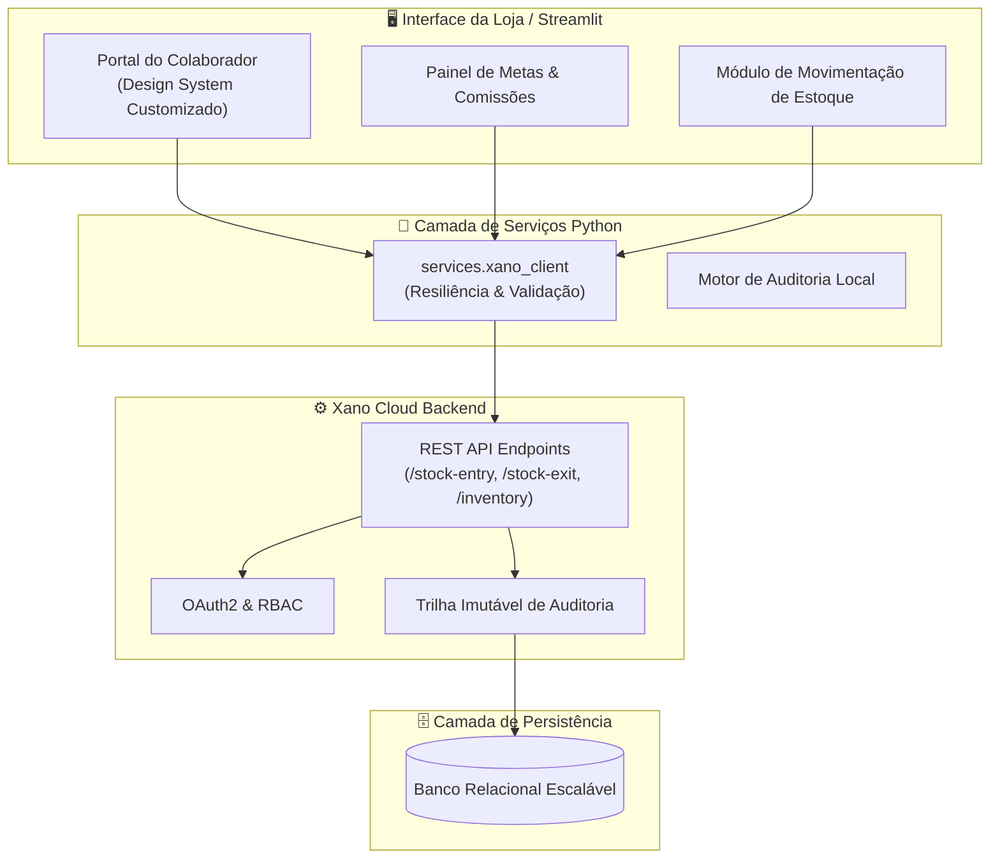

<div align="center">

# 👓 SmartVision™
### Plataforma Integrada de Gestão Óptica, Estoque Auditado & Portal do Colaborador

[](https://www.python.org/)
[](https://streamlit.io/)
[](https://xano.com)
[](#)
[](#)

<p align="center">
  <b>A solução definitiva para redes e boutiques ópticas: conectando a experiência do consultor na loja, metas comerciais, conformidade operacional e controle de estoque de alta precisão em tempo real.</b>
</p>

[Visão Geral](#-visão-geral) •
[Módulos da Plataforma](#-módulos-da-plataforma) •
[Diferenciais de Mercado](#-diferenciais-competitivos) •
[Arquitetura & Engenharia](#-arquitetura-e-engenharia) •
[Instalação & Execução](#-guia-de-inicialização-rápida) •
[Governança OpenSpec](#-governança-e-conformidade)

---

</div>

## 📌 Visão Geral

O **SmartVision** é um ecossistema corporativo completo desenvolvido para superar os principais gargalos do varejo óptico. Softwares generalistas de ERP falham por não compreenderem as particularidades técnicas do setor — como matrizes de dioptrias (graus esféricos, cilíndricos e eixos), controle por lotes de lentes de contato, rastreio de ordens de serviço (OS) e retenção de talentos no salão de vendas.

O SmartVision une um **Portal do Colaborador moderno e intuitivo** com um **Módulo Central de Estoque Auditado**, impulsionado por um backend ágil e escalável via Xano.

---

## 💎 Diferenciais Competitivos

| Desafio Tradicional no Varejo Óptico | Solução SmartVision |
| :--- | :--- |
| **Desmotivação & Falta de Visão de Metas:** Consultores sem clareza sobre comissões diárias e aceleradores. | **Gamificação Comercial:** Painel dinâmico com métricas em tempo real, comissões projetadas e campanhas ativas. |
| **Gargalos de Comunicação Loja-RH:** Documentos em papel, atestados perdidos e comunicados ignorados. | **Central de RH & Mural Digital:** Envio de holerites, espelho de ponto, avisos com confirmação de leitura. |
| **Furos de Estoque & Divergências:** Desvios e perdas em armações e solares de grife. | **Estoque Auditado & Trilha de Auditoria:** Rastreabilidade estrita de cada entrada, saída e ajuste com autor e justificativa. |
| **Complexidade em Lentes Oftálmicas:** Cadastro confuso de parâmetros técnicos e tratamentos. | **Modelagem Especializada:** Gestão nativa de grades técnicas, curvas base, tratamentos (AR/Blue) e validades. |

---

## 🚀 Módulos da Plataforma

```
SmartVision Ecosystem
├── 🏠 O Meu Painel                  (KPIs do consultor, status da escala, agenda diária)
├── 🎯 Metas & Comissões             (Metas por linha, aceleradores de comissão, ticket médio)
├── 📢 Mural do RH & Comunicação     (Informativos, campanhas sazonais, políticas da rede)
├── 📂 Central do Colaborador        (Holerites, ponto eletrônico, atestados e solicitações)
├── 🎓 Academia SmartVision          (Treinamentos técnicos, certificações em lentes e vendas)
├── ⚡ Atalhos Operacionais          (Consulta de receitas, busca rápida de OS e terminal de balcão)
└── 📦 Gestão de Estoque Auditado    (Entradas, saídas rastreadas, alertas de ruptura e conciliação)
```

### 1. 🎯 Gestão de Performance Comercial (Portal do Vendedor)
- Visualização de faturamento pessoal vs. meta do mês com barra de progressão.
- Simulador interativo de comissões com aceleradores por atingimento de linha de lentes Premium.
- Métricas instantâneas: peças vendidas, ticket médio e taxa de conversão.

### 2. 👥 Central de Pessoas & Cultura (RH Integrado)
- **Mural Corporativo:** Notificações de comunicados oficiais e datas comemorativas.
- **Autoatendimento:** Download seguro de demonstrativos de pagamento, conferência de ponto e banco de horas.
- **Academia SmartVision:** Trilhas de capacitação contínua (ex: *Técnicas de Venda de Lentes Multifocais*, *Proteção UV e Materiais de Alto Índice*).

### 3. 📦 Estoque Óptico Auditado (Core Operacional)
- **Rastreabilidade Ponta a Ponta:** Toda movimentação exige motivo padronizado e identificação do operador.
- **Gestão Técnica de Categorias:**
  - *Armações & Solares:* Marca, grife, coleção, cor e controle de display.
  - *Lentes Oftálmicas:* Grade de dioptrias, índice de refração e tratamentos antirreflexo.
  - *Lentes de Contato:* Controle de lotes, datas de validade e descarte.
  - *Insumos de Laboratório:* Blocos, lixas, ventosas e kits de limpeza.
- **Alertas de Ruptura e Giro:** Ponto de reposição dinâmico para evitar falta de itens com alto giro.

---

## 🏗 Arquitetura e Engenharia

O SmartVision foi projetado com uma arquitetura moderna, desacoplada e escalável:



### Stack Tecnológica
- **Interface & UI:** [Streamlit 1.65+](https://streamlit.io/) com sistema de design corporativo exclusivo (Inter font, paleta oficial `#3942F6`, `#F8B807`, `#F8FAFC`).
- **Camada de Aplicação:** [Python 3.11+](https://www.python.org/) estruturado com serviços modulares e testes automatizados (`pytest`).
- **Backend & API Engine:** [Xano](https://www.xano.com/) para lógica transacional, validação de regras de estoque e persistência em nuvem.
- **Metodologia de Mudança:** [OpenSpec](https://openspec.dev/) para governança estrita de especificações e features.

---

## ⚡ Guia de Inicialização Rápida

### Pré-requisitos
- **Python 3.11** ou superior instalado
- **Git**

### Passo a Passo

1. **Acesse o diretório do projeto:**
   ```bash
   cd meu-projeto
   ```

2. **Crie e ative o ambiente virtual:**
   ```bash
   python3 -m venv .venv
   source .venv/bin/activate  # No Windows: .venv\Scripts\activate
   ```

3. **Instale os pacotes necessários:**
   ```bash
   pip install -r requirements.txt
   ```

4. **Configure as variáveis de ambiente:**
   ```bash
   cp .env.example .env
   # Configure sua XANO_BASE_URL no arquivo .env se aplicável
   ```

5. **Inicie o sistema:**
   ```bash
   streamlit run app.py
   ```

6. **Acesse no seu navegador:**
   > A plataforma será iniciada em `http://localhost:8501`.

---

## 🧪 Testes Automatizados

Para garantir integridade transacional dos serviços e do cliente Xano:

```bash
pytest tests/
```

---

## 📋 Governança e Conformidade

O desenvolvimento do SmartVision segue práticas rigorosas de engenharia:
- **Separação de Papéis:** Diretrizes e orquestração documentadas em [AGENTS.md](AGENTS.md).
- **Especificações OpenSpec:** Toda nova feature é registrada com `proposal.md`, `design.md`, `spec.md` e `tasks.md` dentro de `openspec/changes/`.
- **Modelagem de Domínio:** Especificações de entidades de ótica detalhadas em [docs/domain-model.md](docs/domain-model.md) e [docs/project-overview.md](docs/project-overview.md).

---

<div align="center">

**SmartVision Technologies** — *Elevando o padrão de operação e atendimento do mercado óptico.*

© 2026 SmartVision Inc. Todos os direitos reservados.

</div>
